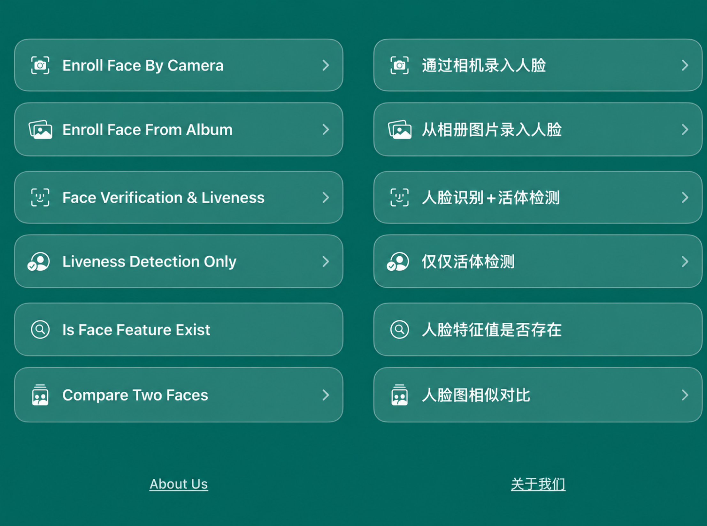

<div align="center">


# FaceAISDK for iOS

**面向 iPhone 与 iPad 的离线人脸检测、人脸识别、活体检测与防欺诈 SDK。**

[](https://github.com/FaceAISDK/FaceAISDK_iOS)


[English](./README.md) · **简体中文**

</div>

---

## 项目简介

FaceAISDK 是一款端侧运行的人脸 SDK，可以为 iOS 与 iPadOS 应用快速接入人脸录入、活体检测和人脸识别能力。所有核心处理均在设备本地完成，运行时无需网络连接。

| | 核心能力 | 说明 |
| :---: | --- | --- |
| 🔍 | 人脸检测 | 在设备端定位并分析人脸 |
| 🪪 | 人脸识别 | 完成人脸录入与身份匹配 |
| 🛡️ | 活体检测 | 识别照片、屏幕等呈现攻击与欺诈行为 |
| ✈️ | 离线运行 | 数据留在本地，无需网络连接 |

### 环境要求

| 项目 | 要求 |
| --- | --- |
| Xcode | 15.2 及以上，已验证至 Xcode 26.5 |
| Swift | 5.9 及以上，兼容 Swift 6.3 |
| 开发语言 | Swift、Objective-C |
| 依赖管理 | CocoaPods |

## 快速集成

### 1. 添加依赖

在 `Podfile` 中加入 `FaceAISDK_Core`，并将版本占位符替换为需要使用的 Release Tag。

```ruby
pod 'FaceAISDK_Core', :git => 'https://github.com/FaceAISDK/FaceAISDK_Core.git', :tag => '2026.*******'

# 或安装已发布的 CocoaPods 版本：
# pod 'FaceAISDK_Core', '2026.*******'
```

### 2. 安装 SDK

```bash
pod install
```

如果只需要更新 FaceAISDK：

```bash
pod update FaceAISDK_Core
```

> [!NOTE]
> 首次安装基础依赖 `TensorFlowLiteSwift` 可能需要约 30 分钟，具体取决于网络环境和设备性能。可以通过 [TensorFlow 压缩包下载地址](https://github.com/tensorflow/tensorflow/archive/refs/heads/master.zip) 检查当前网络是否可以正常访问 GitHub。

## 常见问题

<details>
<summary><strong>FaceAISDK_Core 克隆失败</strong></summary>

以下错误通常由网络不稳定或访问受限导致：

```text
Updating local specs repositories
Downloading dependencies
Installing FaceAISDK_Core 2026.09.20
[!] Error installing FaceAISDK_Core
Cloning into '/var/folders/gh/p4wv4ytj4tn5xrhgq0n_jnbm0000gn/T/d20251020-8626-c57agm'...
fatal: unable to access 'https://github.com/FaceAISDK/FaceAISDK_Core.git/': Error in the HTTP2 framing layer
```

请切换至能够稳定访问 GitHub 的网络环境后重试。

</details>

<details>
<summary><strong>首次运行或更新版本后闪退</strong></summary>

如果 `TensorFlowLiteSwift` 出现以下错误：

```text
Thread 1: EXC BAD ACCESS (code=1, address=0x800008)
```

请在 Xcode 菜单中选择 **Product → Clean Build Folder**，然后更新 SDK：

```bash
pod update FaceAISDK_Core
```

</details>

<details>
<summary><strong>Git 提示 RPC failed、early EOF 或 unexpected disconnect</strong></summary>

错误示例：

```text
[!] Error installing TensorFlowLiteSwift

Cloning into '/var/folders/ft/7cxjq5ss2094sj67mbhnzjrc0000gn/T/d20260113-17932-1xwealt'...
error: RPC failed; curl 18 transfer closed with outstanding read data remaining
error: 3926 bytes of body are still expected
fetch-pack: unexpected disconnect while reading sideband packet
fatal: early EOF
```

请先检查网络连接，必要时适当增大 Git 的 HTTP 缓冲区：

```bash
git config --global http.postBuffer 987654321
git config --global https.postBuffer 987654321
```

</details>

## 相关项目

| 平台 | 仓库 |
| --- | --- |
| iOS · Swift | [FaceAISDK_iOS](https://github.com/FaceAISDK/FaceAISDK_iOS) |
| iOS · Objective-C | [ObjectC_FaceAISDK](https://github.com/FaceAISDK/ObjectC_FaceAISDK) |
| Android | [FaceAISDK_Android](https://github.com/FaceAISDK/FaceAISDK_Android) |
| Flutter | [FaceRecognition_Flutter](https://github.com/FaceAISDK/FaceRecognition_Flutter) |
| uni-app UTS | [FaceAISDK_uniapp_UTS](https://github.com/FaceAISDK/FaceAISDK_uniapp_UTS) |
| React Native | [FaceRecognition_ReactNative](https://github.com/FaceAISDK/FaceRecognition_ReactNative) |

## 效果预览

<p align="center">
  
</p>

## Android Demo

扫描下方二维码即可下载 Android 体验版 APK。

<p align="center">
  
</p>

## 联系我们

如需集成支持，请发送邮件至 [FaceAISDK.Service@gmail.com](mailto:FaceAISDK.Service@gmail.com)。

<div align="center">

快速接入，更私密的端侧人脸识别能力。

</div>
